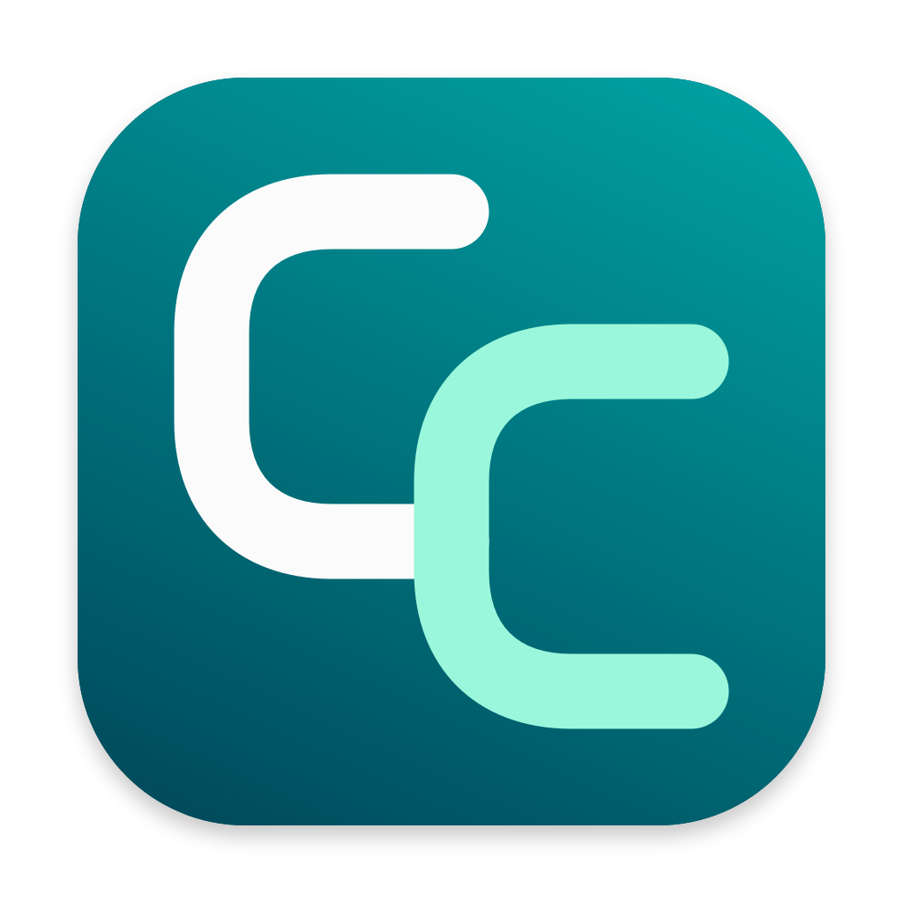
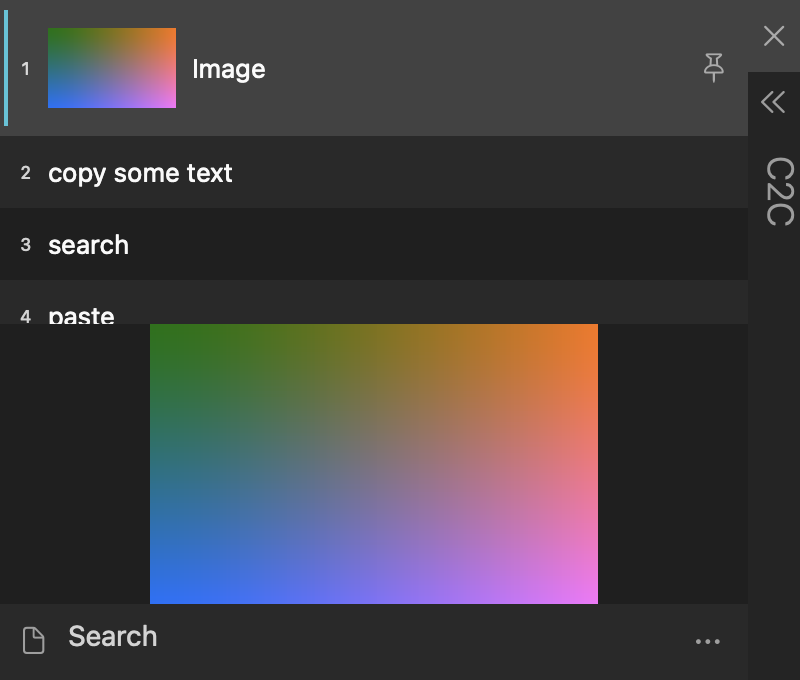

<p align="center">
  
</p>

<h1 align="center">C2C</h1>

<p align="center">A local-first clipboard manager for macOS and Linux.</p>

<p align="center">
  <a href="https://github.com/PDGamerSG/C2C/releases/latest"><strong>Download</strong></a> ·
  <a href="#install">Install</a> ·
  <a href="#build-from-source">Build from source</a> ·
  <a href="https://github.com/PDGamerSG/C2C/issues">Report an issue</a>
</p>

<p align="center">
  
</p>

C2C keeps a searchable history of what you copy so you can find it and paste it again. Pin the snippets you use often, group related clips, or export your history as a JSON archive. Your history stays on your device and works offline.

## What you get

- **Searchable clipboard history.** Save text, rich text, HTML, images, and file references. The clipboard formats available depend on your platform and the app you copy from.
- **Pins and groups.** Keep frequently used clips, assign groups, and switch to a pinned-only view.
- **Automatic cleanup.** Unpinned clips expire 30 days after they were first saved. The history limit can remove them sooner. Pinned clips stay until you unpin them.
- **A native desktop interface.** On macOS, open the menu-bar history with a configurable shortcut and preview captured images. On Linux, browse your history in a GTK4 window.

## Install

| Platform | Download for 1.0.2 | Requirements |
| --- | --- | --- |
| macOS, Apple silicon and Intel | [Universal DMG](https://github.com/PDGamerSG/C2C/releases/download/v1.0.2/C2C-macOS-1.0.2-universal.dmg) | macOS 13 or later |
| Linux, Intel and AMD | [x86-64 archive](https://github.com/PDGamerSG/C2C/releases/download/v1.0.2/C2C-linux-1.0.2-x86_64.tar.gz) | Built and tested on Ubuntu 24.04 with GTK4 |
| Linux, ARM devices | [ARM64 archive](https://github.com/PDGamerSG/C2C/releases/download/v1.0.2/C2C-linux-1.0.2-arm64.tar.gz) | Built and tested on Ubuntu 24.04 with GTK4 |

### macOS

Open the DMG, drag C2C to Applications, and launch it. C2C runs in the menu bar. The release DMG is ad-hoc signed, so Gatekeeper may require you to approve the app in **System Settings → Privacy & Security** on first launch.

### Linux

Install the GTK4 runtime and clipboard helper for your desktop session. On Ubuntu 24.04, use one of these commands:

```sh
# X11
sudo apt install libgtk-4-1 xclip

# Wayland on a compositor supported by wl-clipboard
sudo apt install libgtk-4-1 wl-clipboard
```

Extract the archive, then run `./c2c-linux-1.0.2/bin/c2c` from the directory where you extracted it. The archive includes the Swift runtime. Automatic paste uses `xdotool` on X11 or `wtype` on compatible Wayland compositors when installed.

## First run

**macOS.** Copy something, then press **⌘⇧V** or choose **Show Clipboard** from the C2C menu-bar icon. Type to search and use the arrow keys to select a clip. Press **Return** to paste or **⌘ Return** to paste as plain text. Use **Space** with the history list focused to pin or unpin the selected clip. To paste directly into another app, allow C2C under **System Settings → Privacy & Security → Accessibility**.

Open **Settings** from the menu-bar icon to change the shortcut or choose Light, Dark, or System appearance. Appearance changes apply immediately. To change the shortcut, click the shortcut field, press your key combination, and click **Save**.

**Linux.** Leave the C2C window running while you copy. Search the history, use **Pin** to keep a clip, or toggle **Pinned only** to filter the list. Click a clip to put it back on the system clipboard. You can then switch to the destination app and paste.

## Local data

| Platform | History | Settings |
| --- | --- | --- |
| macOS | `~/Library/Application Support/C2C/clipboard.json` | `~/Library/Application Support/C2C/settings.json` |
| Linux | `$XDG_DATA_HOME/c2c/clipboard.json` | `$XDG_CONFIG_HOME/c2c/settings.json` |

Linux defaults to `~/.local/share` and `~/.config` when the XDG variables are unset. Archive exports contain the copied payloads and their metadata, so treat them like your clipboard history.

## Build from source

Clone the repository and install Swift 6 or later. On macOS, you also need Xcode or the Xcode Command Line Tools.

```sh
git clone https://github.com/PDGamerSG/C2C.git
cd C2C
```

### macOS

```sh
./scripts/build-app.sh
open build/C2C.app
```

To build a universal DMG under `dist/`, run `C2C_MACOS_UNIVERSAL=1 ./scripts/build-dmg.sh`. Set `C2C_SIGNING_IDENTITY` to a Developer ID Application identity for a distribution build and notarize it with Apple.

### Linux

```sh
sudo apt install libgtk-4-dev pkg-config
./scripts/build-linux.sh
```

This writes an archive for the build machine’s architecture under `dist/`.

### Checks

- `./scripts/smoke.sh` exercises the shared store, pin protection, expiration, archive round-trips, and persistence.
- `./scripts/ui-smoke.sh` checks macOS history, appearance, shortcuts, and image capture using sample data. It writes screenshots to `.build/ui-smoke/`. After building the app, `./scripts/system-smoke.sh` checks bundle launch.
- `swift test` and `./scripts/linux-smoke.sh` cover the Linux core and adapters and verify X11 clipboard capture. The Linux smoke script requires `xvfb`, `xauth`, `xclip`, and Python 3.

When opening an issue, include your C2C version, OS, and steps to reproduce. For Linux, include whether you use X11 or Wayland. Use sample clips when sharing screenshots or logs. [GitHub Issues](https://github.com/PDGamerSG/C2C/issues)

## License and credits

C2C is inspired by Ditto Clipboard Manager. [Ditto source](https://github.com/sabrogden/Ditto)

See the [GNU General Public License v3](./Resources/COPYING), [attribution notice](./Resources/NOTICE), and [release notes](./RELEASE_NOTES.md).
